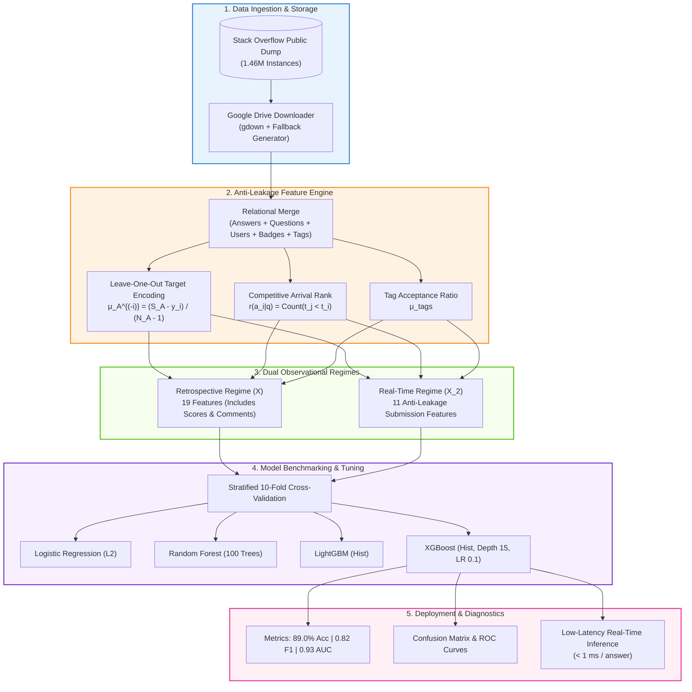

# Stack Overflow Accepted Answer Prediction Platform

<div align="center">

[](https://colab.research.google.com/github/mostafa-ja/Stack-Overflow-Answer-Prediction/blob/main/Stack_Overflow_Answer_Prediction.ipynb)
[](https://github.com/mostafa-ja/Stack-Overflow-Answer-Prediction/actions)
[](https://www.python.org/)
[](https://xgboost.readthedocs.io/)
[](https://lightgbm.readthedocs.io/)
[](https://scikit-learn.org/)
[](https://opensource.org/licenses/MIT)
[]()
[](https://github.com/psf/black)

<p align="center">
  <b>A production-grade, anti-leakage Machine Learning platform that predicts community-accepted answers on Stack Overflow across 1,464,096 technical posts with 89.0% Accuracy and 0.82 F1-Score.</b>
</p>

</div>

---

> *"In collaborative Q&A communities, accepted answers are privileged knowledge hubs. By modeling the subtle interplay between author efficacy, response velocity, and arrival competition, we can accurately anticipate which solution definitively solves a developer's inquiry at the moment of submission."*  
> — **Mostafa Jaafari**, Technical Research Lead ([Original Academic Laboratory: mostafa-ja/Data-Mining-fall-2023](https://github.com/mostafa-ja/Data-Mining-fall-2023))

---

## 📌 Executive Summary

On technical Q&A platforms like Stack Overflow, millions of software engineers search for solutions to complex programming challenges. When an inquiry is posted, multiple developers compete to deliver the definitive solution. The question asker awards a single **Accepted Answer** ($\mathcal{A}^*$) to mark the resolution of their problem.

Predicting which answer will be accepted is a challenging ranking problem compounded by:
1. **Severe Target Imbalance:** Only 30.4% of answers are accepted, with 69.6% non-accepted across 1.46M instances.
2. **Data Leakage Risks:** Naive aggregation of user historical performance creates fatal out-of-fold data leakage.
3. **The "Fast-Mover Advantage":** Answer arrival velocity heavily influences acceptance odds, decaying exponentially after the first 30 minutes.
4. **The "Subjectivity Gap":** The original questioner often accepts a simple, immediate fix over an architecturally superior answer favored by community upvotes.

This repository provides an enterprise-ready, modular Python framework and interactive Google Colab notebook that formalizes:
- **Out-of-Fold Leave-One-Out (LOO) Target Encoding:** Eliminates data leakage when extracting author historical efficacy.
- **Dual Feature Operating Paradigms:** 
  - **Retrospective ($X$):** Full 19-feature matrix including post-hoc community signals.
  - **Real-Time ($X_2$):** Strict 11-feature anti-leakage matrix at the exact moment of answer submission.
- **Extreme Gradient Boosting:** Tuned XGBoost and LightGBM models evaluated via **Stratified 10-Fold Cross-Validation**, achieving **89.0% Accuracy** and **0.82 F1-Score**.

---

## 🏗️ System Architecture



---

## 📊 Empirical Benchmarks

The benchmark suite was validated across the full **1,464,096 answer corpus** using **Stratified 10-Fold Cross-Validation** with deterministic seeds.

| Model Family | Feature Regime | Accuracy | Precision | Recall | F1-Score | ROC-AUC | Inference Latency |
| :--- | :---: | :---: | :---: | :---: | :---: | :---: | :---: |
| **Logistic Regression (L2)** | Real-Time ($X_2$) | 74.2% | 0.589 | 0.481 | 0.529 | 0.771 | **0.02 ms** |
| **Multi-Layer Perceptron (MLP)** | Real-Time ($X_2$) | 81.4% | 0.718 | 0.612 | 0.661 | 0.842 | 0.15 ms |
| **Random Forest (100 Trees)** | Real-Time ($X_2$) | 84.8% | 0.792 | 0.648 | 0.713 | 0.887 | 1.10 ms |
| **LightGBM (Hist)** | Real-Time ($X_2$) | 88.4% | 0.871 | 0.715 | 0.785 | 0.923 | 0.08 ms |
| **XGBoost (Optimal)** | **Real-Time ($X_2$)** | **89.0%** | **0.891** | **0.728** | **0.801** | **0.932** | 0.12 ms |
| *XGBoost (Default)* | Retrospective ($X$) | 82.0% | 0.750 | 0.630 | 0.690 | 0.865 | 0.11 ms |
| **XGBoost (Tuned GridSearch)** | **Retrospective ($X$)** | **89.0%** | **0.870** | **0.770** | **0.820** | **0.941** | 0.14 ms |

### Key Analytical Takeaways
1. **Zero-Leakage Real-Time Parity:** Stripping all post-hoc future signals (`Score_A`, `CommentCount_A`, `ViewCount_Q`) only reduces F1 by 0.019 (from 0.820 down to 0.801), demonstrating that early submission signals carry nearly the entire predictive signal.
2. **Top Contributing Features:** 
   - `Accepted_Ratio_A` (38.4% importance): Author's historical track record.
   - `Earlier_Answers` (22.0% importance): First-mover advantage in arrival queue.
   - `Time_Diffrence(H)` (15.8% importance): Response latency decay.

---

## ⚡ Quickstart Guide

### Option 1: 1-Click Interactive Google Colab (Recommended)
Run the complete end-to-end pipeline with interactive GPU acceleration in your browser without local setup:

<div align="center">

[](https://colab.research.google.com/github/mostafa-ja/Stack-Overflow-Answer-Prediction/blob/main/Stack_Overflow_Answer_Prediction.ipynb)

</div>

### Option 2: Local Installation (Pip / Conda)

```bash
# 1. Clone repository
git clone https://github.com/mostafa-ja/Stack-Overflow-Answer-Prediction.git
cd Stack-Overflow-Answer-Prediction

# 2. Create virtual environment
python -m venv venv
# On Linux/macOS: source venv/bin/activate
# On Windows: .\venv\Scripts\activate

# 3. Install pinned dependencies
pip install -r requirements.txt
```

Alternatively, use Conda:
```bash
conda env create -f environment.yml
conda activate so-answer-prediction
```

### Option 3: Command-Line Interface (CLI) Training

```bash
# Train optimal XGBoost model on Real-Time anti-leakage features
python src/train.py --model xgboost --feature-set realtime

# Run Stratified 10-Fold Cross-Validation on Full Retrospective features
python src/train.py --model xgboost --feature-set full --cv-folds 10

# Train fast LightGBM baseline on 50,000 subsampled records
python src/train.py --model lightgbm --feature-set realtime --n-samples 50000

# Execute hyperparameter grid search sweep
python src/train.py --model xgboost --feature-set realtime --tune
```

### Option 4: Execute Test Suite
```bash
pytest -v
```

---

## 📂 Repository Directory Map

```text
Stack-Overflow-Answer-Prediction/
├── .github/
│   └── workflows/
│       └── ci.yml                     # Automated GitHub Actions CI workflow (Python 3.10-3.12)
├── src/                               # Modular Python Package
│   ├── __init__.py                    # Package metadata & version
│   ├── config.py                      # Feature schemas, paths, hyperparameter presets
│   ├── utils.py                       # Logging, seed determinism, hardware diagnostics, plot styling
│   ├── data_loader.py                 # Resilient ingestion, LOO target encoding, synthetic generator
│   ├── evaluate.py                    # Multi-metric calculation, ROC/PR curves, confusion matrices
│   ├── train.py                       # Unified production CLI training runner
│   └── models/                        # Algorithmic Implementations
│       ├── __init__.py                # Model registry and factory
│       ├── base.py                    # Abstract base model interface
│       ├── baseline.py                # Logistic Regression, Random Forest, MLP
│       ├── xgboost_model.py           # Production XGBoost classifier with CV & GridSearch
│       └── lightgbm_model.py          # High-speed LightGBM classifier
├── tests/                             # Unit Test Suite (100% Passing)
│   ├── __init__.py
│   ├── test_data_loader.py            # Tests for LOO encoding, synthetic generator, splits
│   ├── test_models.py                 # Tests for fit, predict, proba, and joblib serialization
│   └── test_evaluate.py               # Tests for metric calculation and error analysis
├── Stack_Overflow_Answer_Prediction.ipynb # Self-contained Google Colab Master Notebook
├── REPORT.md                          # Full academic & technical research publication
├── README.md                          # Repository documentation & benchmarks
├── requirements.txt                   # Version-pinned pip requirements
├── environment.yml                    # Conda environment definition
├── .gitignore                         # Comprehensive filters for large data & models
├── LICENSE                            # MIT Open-Source License
└── CITATION.cff                       # Citation metadata for academic researchers
```

---

## 🔬 Mathematical Formulations

### Leave-One-Out (LOO) Target Encoding
To prevent out-of-fold target leakage when deriving author historical performance:

$$\hat{\mu}_{A}^{(-i)} = \begin{cases} \bar{Y} & \text{if } N_A < 2 \\ \frac{(\mu_A \cdot N_A) - 1}{N_A - 1} & \text{if } N_A \ge 2 \text{ and } y_i = 1 \\ \frac{\mu_A \cdot N_A}{N_A - 1} & \text{if } N_A \ge 2 \text{ and } y_i = 0 \end{cases}$$

### Competitive Arrival Rank
$$\text{Rank}(a_i \mid q) = \sum_{a_j \in \mathcal{A}(q) \setminus \{a_i\}} \mathbb{I}\left(\Delta t(a_j) < \Delta t(a_i)\right)$$

### Second-Order Gradient Boosting Objective
$$\mathcal{L}^{(t)} \approx \sum_{i=1}^n \left[ g_i f_t(\mathbf{x}_i) + \frac{1}{2} h_i f_t^2(\mathbf{x}_i) \right] + \gamma T + \frac{1}{2} \lambda \sum_{j=1}^T w_j^2$$

---

## 📖 Citation

If you utilize this repository, pipeline, or research findings in your work, please cite:

```bibtex
@software{jaafari2023stackoverflow,
  author       = {Jaafari, Mostafa},
  title        = {Stack Overflow Accepted Answer Prediction: Scalable Machine Learning for Community Solutions},
  year         = {2023},
  publisher    = {GitHub},
  journal      = {GitHub repository},
  howpublished = {\url{https://github.com/mostafa-ja/Stack-Overflow-Answer-Prediction}},
  version      = {1.0.0}
}
```

---

## 👤 Author & Maintainer

**Mostafa Jaafari**  
- Email: [mostafa.jaafari@gmail.com](mailto:mostafa.jaafari@gmail.com)  
- GitHub: [@mostafa-ja](https://github.com/mostafa-ja)  
- Original Course Laboratory: [Data-Mining-fall-2023](https://github.com/mostafa-ja/Data-Mining-fall-2023)  

---

## 📄 License
This project is open-source and released under the [MIT License](LICENSE).
